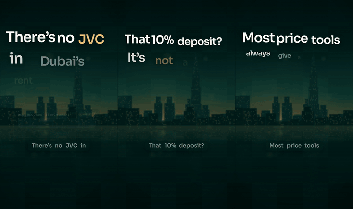

# Repo2Reels

**Make short vertical video reels about your product, for TikTok, Instagram Reels and YouTube Shorts.** Write five lines, and Repo2Reels adds an AI voice-over, word-by-word captions, motion graphics and music, then renders a 1080×1920 MP4 with its cover. It runs on your own computer: free, open source, no API keys, no GPU.

[](https://github.com/sravinp-art/Repo2Reels/actions/workflows/ci.yml)
[](LICENSE)

[](#with-claude-code)



Made with Repo2Reels for [keyva.ae](https://keyva.ae). Watch three in full; press play, then turn the sound on:

<table>
<tr>
<td align="center" width="33%"><video src="https://github.com/user-attachments/assets/2aed93e7-8370-4d9b-b934-60bed5622a4b" controls playsinline width="240"></video><br><sub>There's no JVC in Dubai's rent records</sub></td>
<td align="center" width="33%"><video src="https://github.com/user-attachments/assets/05890fd8-7f2f-4a9f-8eb6-aea6608b6f1e" controls playsinline width="240"></video><br><sub>That 10% deposit? It's not a law</sub></td>
<td align="center" width="33%"><video src="https://github.com/user-attachments/assets/cb3b43d4-320a-4c5a-8446-bb038ae68913" controls playsinline width="240"></video><br><sub>Keyva sometimes won't</sub></td>
</tr>
</table>


## What you get
- **A finished reel**: an MP4 at 1080×1920 and 30 fps, 20 to 30 seconds long, plus a cover image, ready for TikTok, Instagram Reels and YouTube Shorts.
- **A voice-over that has been checked**: [Kokoro](https://huggingface.co/hexgrad/Kokoro-82M), an open text-to-speech model, reads your lines, and Whisper listens back and flags any word it heard differently.
- **Captions word by word**, timed to the voice, never too quick to read and never wrapping onto two lines.
- **Motion graphics**: a big hook in the first two seconds, cards that spring in and push each other out, hand-drawn circles and underlines, transitions and motion blur.
- **Music and sound effects made in code**, in one key and timed to the cuts, so there are no tracks to license.
- **Sound set for phones** (−14 LUFS), and a contact sheet of every reel to check before you post.

## Quick start
You need macOS or Linux (on Windows, use WSL), Python 3.10 or newer, ffmpeg and git.

```bash
git clone https://github.com/sravinp-art/Repo2Reels
cd Repo2Reels
./setup.sh                            # once: Python packages, a headless Chromium, voice models (about 350 MB)
python3 make.py projects/starter      # one 20-second reel: out/starter/repo2reels-reel-1-your-repo-reels.mp4
```

`setup.sh` tells you what to install if anything is missing, and puts the Python packages in a private `.venv` when your system Python won't take them. The starter reel takes about five minutes on a two-core machine, and this is it:

https://github.com/user-attachments/assets/4919cafb-b502-4ee3-b2a7-fdcdd45f1264

## Make reels for your own product

### By hand
```bash
python3 make.py new acme              # projects/acme: a copy of the starter, with your name on it
```
1. In `projects/acme/project.json`, set your brand and write the lines of each reel. Five lines make about 20 seconds; line 1 is the hook.
2. In `projects/acme/scenes.js`, change what is on screen while each line is said. [docs/writing-scenes.md](docs/writing-scenes.md) lists the building blocks, and `projects/keyva` has ten finished reels to borrow from.
3. Run `python3 make.py projects/acme`, then look at the contact sheet in `build/acme/qa/`.

The voice reads words only, so write numbers the way they are said ("twenty percent") and show them as figures in the captions. If a line has digits, or a name the voice doesn't know, `make.py` stops and tells you how to fix it.

### With Claude Code
Add the plugin, then ask for reels from inside your product's repo:

```
/plugin marketplace add sravinp-art/Repo2Reels
/plugin install repo2reels@repo2reels
```

> make 5 reels about this product with repo2reels

The skill reads your code and docs for facts worth a reel, writes the hooks and scripts, builds the scenes, runs the pipeline, listens to every line and checks every frame.

## How it works: brag × Remotion
Repo2Reels mixes two projects. [brag](https://github.com/latent-spaces/brag) is an agent skill with sharp creative rules for launch videos. [Remotion](https://www.remotion.dev) makes video with code, frame by frame, with springs, transitions and motion blur. Repo2Reels keeps brag's rules and rebuilds Remotion's motion ideas in one plain HTML page. A small Python pipeline then handles the voice, the music, the render and the checks. There's no React and no Node.

| From brag | From Remotion | Added by Repo2Reels |
|---|---|---|
| The hook lands in the first 2 seconds | Each frame is a function of time: `render(t)` | Facts taken from the product's repo, each with its source |
| One real fact per reel, with the real product on screen | Springs, easing, `interpolate` | A voice-over spoken from phonemes and heard back by Whisper |
| Every frame works as a still | Iris, push and flip transitions | Hand-drawn circles, underlines and highlights |
| Voice written first, cuts on the beat | Motion blur, light leaks | Cards that grow as their rows arrive |
| Music and effects in one key | `fitText`, word-by-word captions | Captions that never flash past or wrap |
| Cover as frame 0, share copy included | | −14 LUFS mastering, contact-sheet checks |

The full story, and what the first batch taught us, is in [docs/how-it-works.md](docs/how-it-works.md).

## The pipeline

| Step | What happens | Output |
|---|---|---|
| `voice` | Words to phonemes (the misaki dictionary plus yours), then Kokoro speaks each line | `build/<p>/vo/*.wav` |
| `listen` | Whisper transcribes each line and flags any drift from the script (`--listen`) | report |
| `timing` | Lines placed on a 120 bpm grid, every word timed | `build/<p>/timing.json` |
| `page` | Engine, world, your scenes and brand assembled into one page | `build/<p>/reel.html` |
| `events` | Sound cues, motion-blur windows and the cover time, read from the page | `build/<p>/events.json` |
| `score` | Music, sound effects and voice mixed, with the music ducked under the voice | `build/<p>/audio/*.wav` |
| `posters` | The cover frame of each reel | `build/<p>/posters/*.png` |
| `render` | Every frame, motion-blurred where things move fast | `build/<p>/pic/*.mp4` |
| `encode` | Cover, picture and sound, set to −14 LUFS | `out/<p>/*.mp4`, `*.jpg` |
| `qa` | Contact sheets, plus checks on hook width and caption timing | `build/<p>/qa/*.jpg` |

Run any steps on their own with `--steps page,events,render`, and for some reels only: `python3 make.py projects/keyva r11 r18`. Render several reels at once with `--workers 2`. A line is only spoken again if its words or the voice changed.

## Questions

**Do I need an account, an API key or a GPU?** No. Once `setup.sh` has downloaded the models, everything runs offline on your computer's processor.

**Which computers does it run on?** macOS and Linux. Every change is checked by making the starter reel on both. On Windows, use WSL.

**Can I change the voice?** Yes: set `"voice": {"voice": "am_michael"}` in `project.json`. Any of Kokoro's 20 American English voices works (`af_heart`, `af_bella`, `am_adam`, `am_michael` and others).

**Which languages?** English only for now: the pronunciation dictionary is American English.

**Can I use my own music?** Not yet. Each reel's music is generated to fit its cuts and cues.

**Can I post the reels commercially?** Repo2Reels adds no third-party audio or footage to a reel: the voice comes from Kokoro (Apache-2.0), the fonts are under the SIL Open Font License, and the music is generated by the code. The code itself is MIT. What you put in your reels is up to you.

**How is it different from Remotion?** Remotion is a React framework for making any kind of video in code. Repo2Reels is a ready-made pipeline for one kind of video, the product reel, with the voice, music, captions and checks built in. It borrows Remotion's motion ideas, written from scratch in plain JavaScript.

**Why the name?** With the Claude Code plugin, you point it at your product's repo and it finds the facts worth a reel in there.

## What's inside

```
engine/      the reel page: motion toolkit, scene kit, captions, end card, the dusk-skyline world, fonts
r2r/         the pipeline: voice, listen, timing, build, page, score, render, encode, qa
projects/    one folder per product: starter (one reel, the template) and keyva (ten reels, the worked example)
skills/      the Claude Code skill
docs/        how it works, and how to write scenes
```

## Contributing
Bug reports, new scenes, new worlds and fixes are welcome. [CONTRIBUTING.md](CONTRIBUTING.md) says how to test a change.

## Credits
- [brag](https://github.com/latent-spaces/brag) by Shunit Haviv Hakimi (MIT): the creative rules.
- [Remotion](https://www.remotion.dev): the motion ideas, reimplemented here. Repo2Reels contains no Remotion code and is not affiliated with Remotion.
- Voice: [Kokoro](https://huggingface.co/hexgrad/Kokoro-82M) through [kokoro-onnx](https://github.com/thewh1teagle/kokoro-onnx), and the [misaki](https://github.com/hexgrad/misaki) dictionary. Listening: Whisper through [sherpa-onnx](https://github.com/k2-fsa/sherpa-onnx). Fonts: Sora, Space Mono and Inter (SIL OFL).

The code is MIT-licensed, and so is the starter project. The Keyva name, logo and reels (`projects/keyva`, and the Keyva reels, covers and showcase in `media/`) belong to Keyva. See [THIRD_PARTY_NOTICES.md](THIRD_PARTY_NOTICES.md).
